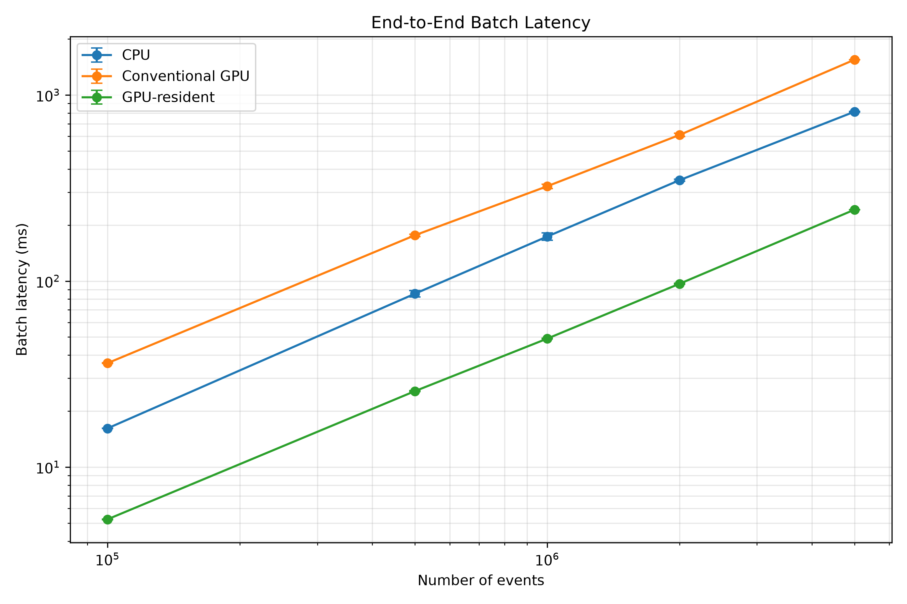
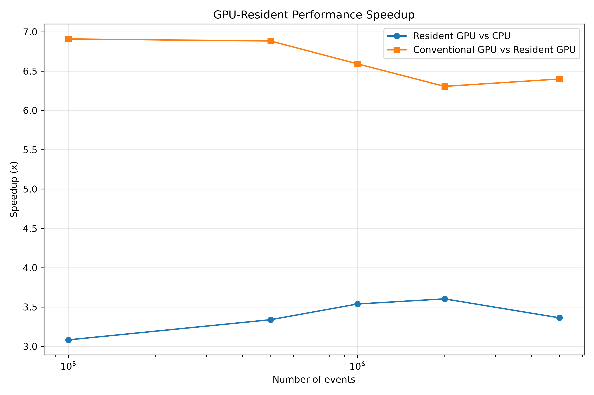
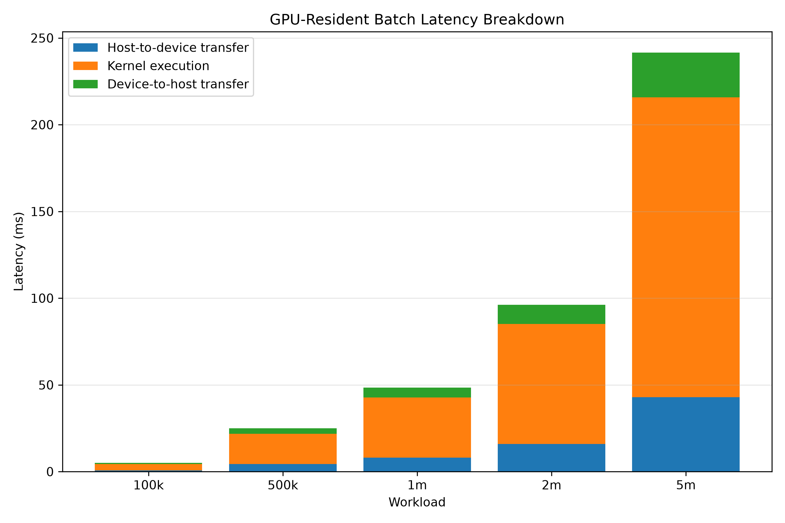
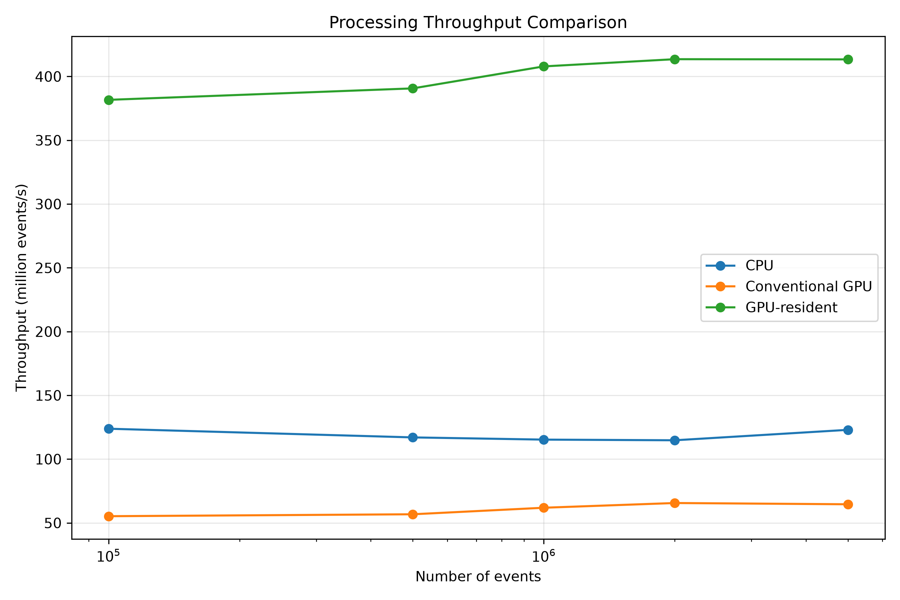

# CUDA-Accelerated Market Microstructure Analytics

A C++ and NVIDIA CUDA project exploring GPU acceleration for financial market microstructure analytics through parallel processing of synthetic market data.

The project implements market analytics on both CPU and GPU, benchmarks their performance at different event volumes, and investigates the trade-off between GPU computation speed and CPU–GPU data-transfer overhead.

## Project Overview

Financial market systems process large volumes of market data, including bid prices, ask prices, order quantities and executed trades.

This project explores how NVIDIA CUDA can accelerate computationally intensive market analytics by distributing calculations across GPU threads.

The implementation currently supports:

- Bid-ask spread calculation
- Mid-price calculation
- Order Book Imbalance (OBI)
- Market signal classification
- Volume Weighted Average Price (VWAP)
- CPU vs GPU performance benchmarking

**Project objective:** Evaluate GPU parallelisation for market microstructure analytics and understand the impact of memory transfers on end-to-end performance.

## System Architecture

```text
             Synthetic Market Data
                       |
                       v
              Market Data Generator
                       |
                       v
                 Input Arrays
                       |
              +--------+--------+
              |                 |
              v                 v
         CPU Analytics      GPU Analytics
              |                 |
              |            CUDA Kernels
              |                 |
              |            Parallel OBI
              |            Spread & Mid
              |            Signal Analysis
              |            VWAP Reduction
              |                 |
              +--------+--------+
                       |
                       v
               Results Comparison
                       |
                       v
               Performance Analysis
```

## Technology Stack

| Component | Technology |
|---|---|
| Programming language | C++ |
| GPU programming | NVIDIA CUDA C++ |
| Compiler | NVCC |
| Parallel processing | CUDA kernels |
| CPU benchmarking | C++ chrono |
| Data generation | C++ random library |
| Operating system | Ubuntu 24.04 |
| CUDA Toolkit | 12.0 |
| GPU architecture | NVIDIA Maxwell (sm_50) |

## Hardware Configuration

The initial experiments were performed on:

| Component | Specification |
|---|---|
| GPU | NVIDIA GeForce 940MX |
| GPU Compute Capability | 5.0 |
| GPU Memory | 4 GB |
| CPU | Intel processor |
| Integrated GPU | Intel UHD Graphics 620 |
| Operating System | Ubuntu 24.04 |

The CUDA implementation is compiled specifically for the Maxwell GPU architecture using `-arch=sm_50`.

## Project Structure

```text
cuda-hft-market-microstructure/
│
├── src/
│   ├── hello_cuda.cu
│   ├── market_generator.cpp
│   └── hft_analytics.cu
│
├── include/
│
├── benchmarks/
│
├── python/
│
├── results/
│
├── .gitignore
└── README.md
```

## Market Analytics

### 1. Bid-Ask Spread

Measures the difference between the best ask and best bid prices.

```text
Spread = Ask Price - Bid Price
```

### 2. Mid-Price

Calculates the midpoint between the best bid and ask.

```text
Mid Price = (Bid Price + Ask Price) / 2
```

### 3. Order Book Imbalance (OBI)

Measures the relative difference between bid and ask quantities.

```text
OBI = (Bid Quantity - Ask Quantity)
      / (Bid Quantity + Ask Quantity)
```

Positive values indicate relatively greater bid-side quantity, while negative values indicate relatively greater ask-side quantity.

### 4. Market Signal Classification

Classifies market conditions into:

- Buy Pressure
- Sell Pressure
- Neutral

The classification is based on the implemented market analytics logic.

### 5. Volume Weighted Average Price (VWAP)

Calculates the volume-weighted average execution price.

```text
VWAP = Sum(Trade Price × Trade Quantity)
       / Sum(Trade Quantity)
```

The GPU implementation uses parallel partial reductions followed by a final reduction.

## CUDA Implementation

The project uses a Structure of Arrays (SoA) memory layout for market data.

Input arrays include:

- `bid[]`
- `ask[]`
- `bidQty[]`
- `askQty[]`
- `tradePrice[]`
- `tradeQty[]`

The main CUDA analytics kernel distributes market events across GPU threads.

The implementation also uses shared memory for partial VWAP reduction.

**Current configuration:**

- CUDA threads per block: 256
- Default workload: 1,048,576 events
- Data processing: Parallel GPU execution
- VWAP: Two-stage reduction

## Compilation and Execution

### Prerequisites

- Ubuntu/Linux
- NVIDIA GPU with CUDA support
- NVIDIA driver
- CUDA Toolkit
- C++ compiler

### Compile CUDA Analytics

```bash
nvcc -O2 -std=c++17 -arch=sm_50 \
src/hft_analytics.cu -o hft_analytics
```

### Run with Default Workload

```bash
./hft_analytics
```

### Run with Custom Workload Sizes

```bash
./hft_analytics 100000
./hft_analytics 500000
./hft_analytics 1048576
./hft_analytics 2097152
./hft_analytics 5242880
```

The workload can be adjusted through the command-line argument.

## Initial Benchmark Results

The following results were collected on the NVIDIA GeForce 940MX.

| Events | CPU Time (ms) | GPU Kernel (ms) | GPU End-to-End (ms) | Kernel Speedup |
|---:|---:|---:|---:|---:|
| 100,000 | 3.747 | 0.249 | 2.845 | 15.07× |
| 500,000 | 8.122 | 0.991 | 9.550 | 8.20× |
| 1,048,576 | 17.207 | 1.972 | 18.953 | 8.72× |
| 2,097,152 | 34.069 | 3.833 | 35.707 | 8.89× |
| 5,242,880 | 83.901 | 9.497 | 87.048 | 8.83× |

*Note: These are initial single-run measurements, not statistically averaged results.*

### Performance Observations

1. GPU kernel execution achieved approximately 8.8× speedup at larger workloads.
2. GPU execution time scaled effectively as the event count increased.
3. End-to-end execution was slower than CPU execution for most tested workloads.
4. CPU–GPU data transfers and associated overhead reduced the overall performance benefit.

This demonstrates an important distinction between kernel-level acceleration and application-level performance.

### Kernel Speedup vs End-to-End Speedup

**Kernel-only speedup:**

```text
CPU Execution Time / GPU Kernel Execution Time
```

**End-to-end speedup:**

```text
CPU Execution Time / GPU End-to-End Execution Time
```

The two measurements are reported separately because GPU kernel execution excludes data-transfer overhead, whereas end-to-end execution includes it.

## GPU-Resident Market Analytics Benchmark

### Objective

Investigate how GPU-resident data processing affects end-to-end performance by reducing repeated CPU–GPU memory transfers.

The experiment compares three execution strategies:

1. **CPU:** Processes the dataset 20 times using preallocated output buffers.
2. **Conventional GPU:** Transfers input data to the GPU, executes analytics and transfers results back on every pass.
3. **GPU-resident:** Transfers input data once, executes 20 analytics passes on the GPU and transfers results back once.

### Experimental Configuration

| Parameter | Configuration |
|---|---|
| GPU | NVIDIA GeForce 940MX |
| Architecture | Maxwell |
| Compute capability | 5.0 |
| CUDA architecture target | sm_50 |
| CUDA Toolkit compiler | NVCC 12.0 |
| CUDA threads per block | 256 |
| Warm-up batches | 3 |
| Measured batches | 20 |
| Analytics passes per batch | 20 |
| Workload sizes | 100K, 500K, 1M, 2M, 5M |

GPU memory allocation and initialisation are measured separately as setup time and excluded from steady-state batch latency.

### Benchmark Results

The following results represent mean latency across 20 measured batches.

| Events | CPU (ms) | Conventional GPU (ms) | GPU-resident (ms) | Resident Speedup |
|---:|---:|---:|---:|---:|
| 100,000 | 16.151 | 36.200 | 5.240 | 3.08× |
| 500,000 | 85.448 | 176.181 | 25.597 | 3.34× |
| 1,000,000 | 173.474 | 323.189 | 49.031 | 3.54× |
| 2,000,000 | 348.509 | 609.888 | 96.721 | 3.60× |
| 5,000,000 | 813.262 | 1547.996 | 241.899 | 3.36× |

Resident speedup is calculated as:

```text
CPU Batch Latency / GPU-Resident Batch Latency
```

### GPU-Resident Timing Breakdown

The GPU-resident implementation separately measures:

- Host-to-device (H2D) transfer time.
- CUDA kernel execution time.
- Device-to-host (D2H) transfer time.
- End-to-end batch latency.

At 5 million events, the mean timing breakdown was:

| Component | Time (ms) |
|---|---:|
| H2D | 42.900 |
| Kernel execution (20 passes) | 172.828 |
| D2H | 25.811 |
| End-to-end | 241.899 |

### Performance Observations

1. GPU-resident execution achieved a 3.08×–3.60× speedup over CPU execution across the tested workloads.
2. The highest observed speedup was 3.60× at 2 million events.
3. GPU-resident execution was approximately 6.31×–6.91× faster than conventional GPU execution.
4. Repeated host-device transfers significantly affected conventional GPU end-to-end performance.
5. Kernel execution represented the largest component of GPU-resident batch latency.

### Statistical Analysis

Each workload contains 20 measured batches following three warm-up batches.

The analysis script calculates:

- Mean and median latency.
- Standard deviation.
- Minimum and maximum latency.
- 95% confidence intervals using the Student's t distribution.
- Processing throughput for complete execution paths.

The raw measurements are preserved in `benchmarks/`, while consolidated statistical results are available in:

`benchmarks/analysis/resident_statistics.csv`

### Performance Visualisations

The following figures are generated from the recorded benchmark measurements:

**1. End-to-end latency comparison**



**2. GPU-resident speedup**



**3. GPU-resident latency breakdown**



**4. Processing throughput**



### Reproducing the GPU-Resident Experiments

Compile:

```bash
nvcc -O2 -std=c++17 -arch=sm_50 \
src/hft_analytics.cu -o hft_analytics_research
```

Run an individual workload:

```bash
./hft_analytics_research --resident 100000
```

Run statistical analysis using the five saved raw datasets:

```bash
python scripts/analyze_resident_results.py
```

Generate figures:

```bash
python scripts/plot_resident_results.py
```

### Experimental Limitations

- Market data is synthetically generated.
- The experiment evaluates repeated processing of the same input dataset.
- GPU-resident execution reuses data across 20 analytics passes.
- Results do not represent live market-feed processing or production HFT latency.
- GPU setup time is reported separately from steady-state batch latency.
- Results are specific to the tested hardware and software configuration.

## Verification

The implementation compares CPU and GPU analytics results.

Current test runs report:

```text
Verification: PASSED
```

This indicates that the implemented verification checks passed for the tested workloads.

## Development Roadmap

### Phase 1 — Core CUDA Analytics
- [x] CUDA environment setup
- [x] Synthetic market data generation
- [x] CPU analytics implementation
- [x] GPU analytics implementation
- [x] Parallel VWAP reduction
- [x] Variable workload support
- [x] Initial CPU vs GPU benchmarking

### Phase 2 — Benchmarking and Optimisation
- [x] Repeated benchmark measurements
- [x] Mean, median, minimum and maximum execution time
- [x] Throughput measurement
- [x] CPU-to-GPU transfer time analysis
- [x] GPU-resident batch processing (single H2D transfer, repeated GPU execution, single D2H transfer)
- [ ] CUDA block-size experimentation
- [ ] Memory access optimisation
- [ ] Pinned host memory experiments

### Phase 3 — Advanced Market Microstructure
- [ ] Order Flow Imbalance (OFI)
- [ ] Rolling VWAP
- [ ] Trade imbalance
- [ ] Price momentum
- [ ] Spread dynamics

### Phase 4 — Performance Visualisation
- [x] CPU vs GPU execution-time graphs
- [x] Throughput comparison
- [x] Kernel speedup visualisation
- [x] Memory-transfer overhead analysis
- [x] Benchmark result exports
- [x] GPU-resident benchmark visualisation
- [x] Statistical analysis with 95% confidence intervals
## Project Scope

This is an educational and experimental CUDA market analytics project.

It explores GPU parallelisation and performance characteristics using synthetic market data. It is not an exchange-grade trading system, production execution engine or validated trading strategy.

The objective is to develop practical experience in GPU programming, parallel algorithms, memory management and performance benchmarking.

## Author

**Prathamesh Kulkarni**

Master of Electrical and Electronics Engineering  
University of Melbourne

Interested in GPU Computing, Computer Architecture, FPGA Design, Low-Latency Systems and Hardware Acceleration.
